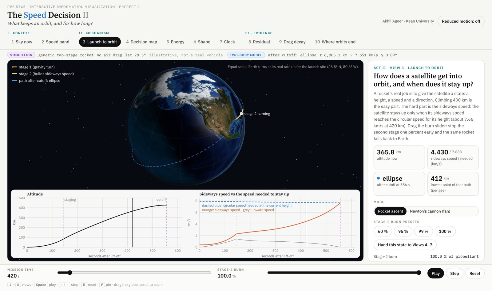
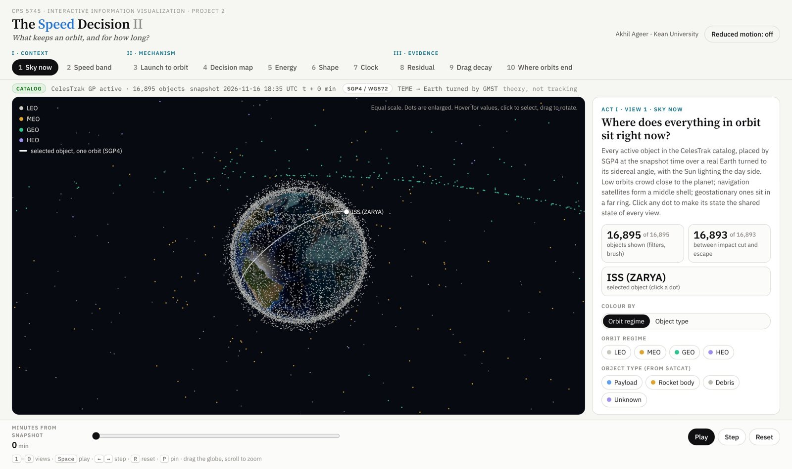
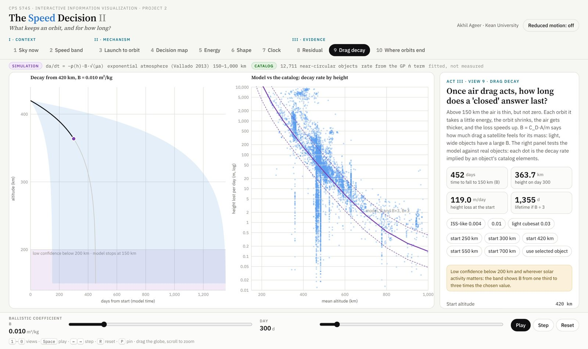
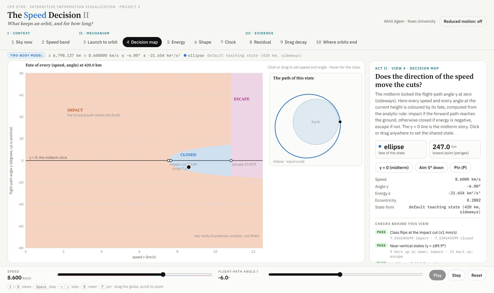
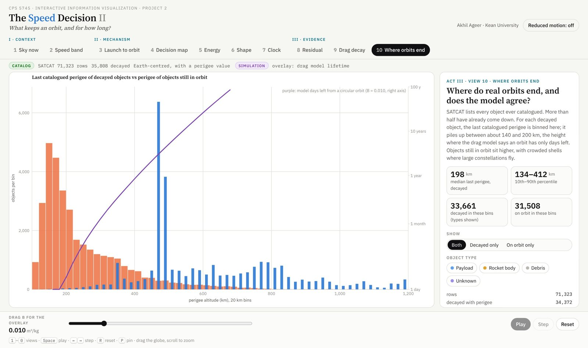

# The Speed Decision II

**What keeps an orbit, and for how long?** CPS 5745 Interactive Information Visualization, Project 2 (Kean University, Fall 2026). Akhil Ageer.

Live app: https://speed-decision-2.vercel.app · Demo video: [media/speed_decision_2_demo.mp4](media/speed_decision_2_demo.mp4) (92 s) · Midterm (Project 1): https://the-speed-decision.vercel.app



The midterm showed one sharp rule: at 420 km, launched sideways, **speed alone decides** whether an object hits the Earth, stays in orbit, or escapes (cuts 7.534, 7.657 and 10.829 km/s). Project 2 tests that rule against every object in orbit today, shows how a rocket gives a satellite its state, lets the launch angle vary, and then shows how air drag ends a "closed" orbit, compared with the catalog record of where real orbits ended.

## Ten linked views in three acts

| # | Act | View | Question | Data / model |
|---|-----|------|----------|--------------|
| 1 | Context | Sky now | Where does everything in orbit sit right now? | CelesTrak GP (active) + SGP4, real Earth by GMST |
| 2 | Context | Speed band | At its own height, is every object between the cuts? | GP + SGP4; two-body cut curves; altitude brush |
| 3 | Mechanism | Launch to orbit | How does a satellite get into orbit, and when does it stay up? | Ascent simulation (generic two-stage rocket) → two-body; Newton's cannon fan |
| 4 | Mechanism | Decision map | Does the direction of the speed move the cuts? | Two-body, analytic class regions over (v, γ) |
| 5 | Mechanism | Energy | Why does escape happen at one speed only? | Derived scalar ε = v²/2 − μ/r |
| 6 | Mechanism | Shape | Is shape the fate? Where does perigee reach the ground? | e and perigee vs speed |
| 7 | Mechanism | Clock | What does a closed orbit do over time? | Kepler's second law, equal-time wedges |
| 8 | Evidence | Residual | How far is the textbook path from the catalog theory? | SGP4 vs two-body from the same state, any object |
| 9 | Evidence | Drag decay | Once drag acts, how long does "closed" last? | Drag simulation vs decay rates from GP ṅ |
| 10 | Evidence | Where orbits end | Where do real orbits end; does the model agree? | SATCAT perigee histograms + model lifetime |

All views share one state: selected object, height brush, (r, v, γ), time, drag parameter B and pins. Every view carries a model badge (catalog, SGP4, two-body model, simulation, derived) and a strip of the checks behind its numbers.

Keys: `1`–`0` views, `Space` play/pause, `←`/`→` step, `R` reset, `P` pin. A reduced-motion switch is in the header (it also follows the system setting).

## Screenshots

| Sky now | Drag decay vs the catalog |
|---|---|
|  |  |
| **Decision map** | **Where orbits end** |
|  |  |

## Run it

```sh
./launch.sh          # builds web/data from data/raw, runs the checks, serves http://127.0.0.1:8746/
```

To record the demo video again: serve `web/`, run `node tools/record_demo.cjs http://127.0.0.1:8746 /tmp/frames` (Playwright), then `ffmpeg -framerate 30 -i /tmp/frames/f%05d.png -c:v libx264 -crf 21 -pix_fmt yuv420p demo.mp4`.

The page is a static folder (`web/`): three.js, satellite.js and plain JavaScript, no build step. SGP4 for all objects runs in a Web Worker.

## Data (hashed snapshots in `data/raw/`)

* **D1 · CelesTrak GP, GROUP=active** (JSON). Catalog of fitted mean elements for active objects. Source: https://celestrak.org/NORAD/elements/gp.php?GROUP=active&FORMAT=json
* **D2 · CelesTrak SATCAT** (CSV). Every catalogued object, including decayed ones. Source: https://celestrak.org/pub/satcat.csv
* **D3 · ISS (ZARYA) GP record of 5 Oct 2026** (the midterm story object, SHA-256 `7738ac44…`).

Sizes, SHA-256 hashes, retrieval times and every exclusion count are in `web/data/provenance.json`. Blanks stay missing (never 0); percentages are recomputed from counts; medians come from raw rows.

## Models

* **Two-body** (midterm code, unchanged): μ = 398,600.4418 km³/s², universal variables; class rule = impact if the forward path reaches R = 6,378.137 km (1 m tolerance), else closed if ε < 0, else escape.
* **SGP4/WGS72** (satellite.js 7.1.0): catalog theory, not a measurement.
* **Drag decay** (simulation): da/dt = −ρ(h)·B·√(μa), exponential atmosphere from Vallado (2013), valid 150–1,000 km, near-circular orbits, fixed average atmosphere (no solar activity).
* **Launch ascent** (illustrative simulation): generic two-stage rocket, point mass, one plane, no air drag, 28.5° N. Not a real vehicle.

## Checks

`python3 pipeline/verify.py` (also run by `launch.sh`) writes `web/data/checks.json`; the page also runs live checks at load:

* C1 cuts at 420 km equal the midterm table · C2 ISS decay term · C3 drag integrator vs closed form · C5 SATCAT counts from the raw file
* B1–B6 boundary cases (impact cut ±1 mm/s, γ = ±89.9°, v = 0, B = 0, start below 150 km refused)
* A1 ascent: 100 % stage-2 burn closes, 99 % falls back · P1 raw hashes · P2 browser SGP4 vs python-sgp4 for every object · P3 JS ports vs Python
* R1 the page reproduces the midterm residual (72.206 km at 93.0 min)

## Credits

NASA Blue Marble / Black Marble imagery (public domain), Natural Earth (public domain), CelesTrak (T. S. Kelso) data, three.js (MIT), satellite.js (MIT), IBM Plex and Source Serif 4 (OFL). Code written with AI assistance (Claude); every number is checked by the scripts above.

MIT License.
